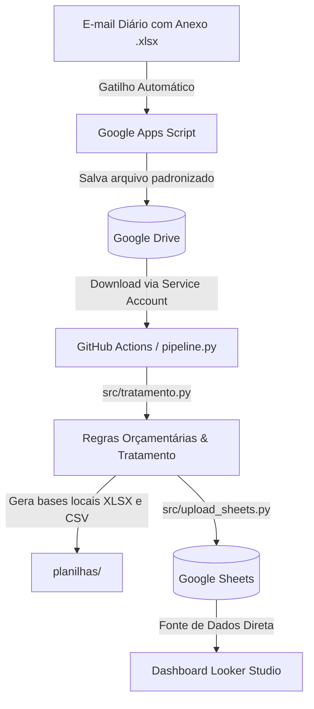

# Painel de Execução Orçamentária — PRAD / UFPI

Pipeline automatizado de ingestão, tratamento e disponibilização dos dados de execução da despesa da Pró-Reitoria de Administração (PRAD) da UFPI para o painel analítico no Looker Studio.

---

## 🏗️ Arquitetura do Fluxo de Dados



---

## 📁 Estrutura do Projeto

```text
painel/
├── .github/
│   └── workflows/
│       └── atualizacao_diaria.yml    # Agendamento diário (seg-sex às 08:30 BRT)
├── assets/ (ou imagens/)             # Recursos visuais e logotipos do dashboard
├── docs/
│   ├── Manual-de-classificacao-*.pdf # Manual de referência de classificação
│   └── dicionario_variaveis.txt      # Dicionário de campos e colunas calculadas
├── google_apps_script/
│   └── salvar_anexo_drive.js         # Script executado no Apps Script (Gmail -> Drive)
├── legacy/
│   └── download_email.py             # Script legado de download direto via IMAP
├── planilhas/                        # Dados locais de entrada e saída (ignorado no Git)
│   ├── Execução da despesa.xlsx      # Planilha bruta mais recente
│   ├── Base_Tratada_Painel_PRAD.xlsx # Base processada em Excel
│   └── Base_Tratada_Painel_PRAD.csv  # Base processada em CSV
├── src/
│   ├── __init__.py
│   ├── download_drive.py             # Ingestão via Google Drive API (Service Account)
│   ├── tratamento.py                 # Motor de regras de negócio, RAP e métricas
│   └── upload_sheets.py              # Exportação para o Google Sheets (gspread)
├── pipeline.py                       # Orquestrador principal de ponta a ponta
├── requirements.txt                  # Dependências do projeto
└── README.md                         # Documentação do repositório
```

---

## ⚙️ Regras de Negócio e Tratamento (`src/tratamento.py`)

1. **Classificação Contratual:** Identificação de despesas "Com contrato" ou "Sem contrato" via códigos e siglas de Processos Internos (PI).
2. **Natureza da Despesa:** Padronização por código de 6 dígitos em Categorias (*Despesas Correntes* vs *Despesas de Capital*) e descrições otimizadas para gráficos.
3. **Métricas de Execução e RAP:**
   * **Montante:** Soma de Empenho + RAP Não Processado (`RAP_NP_Inscritos` + `RAP_NP_Reinscritos`).
   * **Execução (Liquidação):** `Despesas_Liquidadas` + `RAP_NP_Liquidados`.
   * **Saldos Segregados:** Separação estrita entre o saldo a liquidar de **Restos a Pagar** e o saldo do **Exercício Atual**.
   * **Saldo a Pagar:** Execução/Liquidação menos Total Geral Pago.
   * **Conferência de Inconsistências:** Alerta automático para eventuais saldos negativos ou pagamentos superiores à liquidação.

---

## 🚀 Como Executar Localmente

### 1. Pré-requisitos
* Python 3.10 ou superior
* Credencial de Service Account do Google Cloud (`automacao-prad-*.json` na raiz ou variável `GCP_SA_KEY`)

### 2. Instalação das Dependências
```bash
python -m venv .venv
source .venv/bin/activate  # No Linux/macOS
pip install -r requirements.txt
```

### 3. Execução do Pipeline Completo
```bash
python pipeline.py
```

O pipeline executará em sequência:
1. `[1/3]` Download da planilha mais recente do Google Drive (ou uso de arquivo local em `./planilhas`);
2. `[2/3]` Tratamento das 20 colunas e aplicação de todas as regras orçamentárias;
3. `[3/3]` Sincronização automática com a planilha do Google Sheets.

---

## ☁️ Automação em Nuvem (GitHub Actions)

O arquivo `.github/workflows/atualizacao_diaria.yml` executa automaticamente de segunda a sexta-feira às 08:30 (Horário de Brasília) utilizando os seguintes Secrets do repositório:
* `GCP_SA_KEY`: Conteúdo JSON da chave da Service Account.
* `GOOGLE_DRIVE_FOLDER_ID`: ID da pasta do Google Drive onde o Apps Script deposita a planilha diária.
